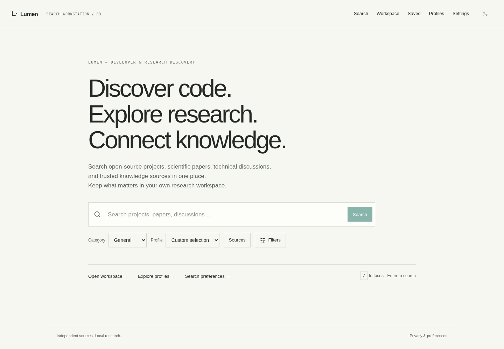

# LUMEN — Developer & Research Discovery

**Discover code. Explore research. Connect knowledge.**

LUMEN is an open-source, self-hosted discovery workspace for developers, students, researchers, engineers and technical learners. It searches six public sources through one interface, explains its ranking, and lets you compare and save findings in your browser. No account or third-party API key is required.



## Repository profile

| Area | Current implementation |
| --- | --- |
| Frontend | Next.js 16, React 19, TypeScript and Bun in `frontend/` |
| Backend | Python 3.12, FastAPI, HTTPX and uv in `backend/` |
| Data | Browser-local profiles, preferences, collections and notes; bounded in-memory backend cache |
| Deployment and checks | `compose.yml`, `.env.example` and `.github/workflows/ci.yml`; no database, Redis or SearXNG service |

## What LUMEN searches

| Source | Discover |
| --- | --- |
| GitHub | Open-source repositories |
| Wikipedia | Encyclopedic knowledge |
| Crossref | Scholarly publication metadata |
| arXiv | Scientific papers and preprints |
| Hacker News | Technology submissions and discussions |
| Wikimedia Commons | Openly licensed images |

All six sources are enabled by default. The built-in **General**, **Developer**, **Research** and **News** profiles offer useful starting points; News covers technology submissions from Hacker News, not general news. The science category can include arXiv. You can select sources and filters, inspect per-source status and ranking details, compare profiles, and keep collections, notes and tags in your browser. Optional search history starts disabled.

## Run locally

Install Docker Engine with the Compose plugin, then run:

```sh
git clone https://github.com/namelessweakl1ng/LUMEN.git
cd LUMEN
python tools/configure.py
docker compose up --build -d
curl --fail http://localhost:3000/api/v1/health
```

Open `http://localhost:3000`. Try a repository search with **Developer**, switch to **Research** or the science category for papers, save a result to the **Research workspace**, and compare profiles from the comparison view. The configuration helper creates an internal proxy secret in ignored `.env`; it is not a provider credential. Compose publishes only the frontend on port 3000. Use `docker compose down` to stop the stack. See [deployment](docs/deployment.md) for local development without Docker, HTTPS and runtime configuration.

## How it works

```text
Browser / Next.js / IndexedDB
  -> same-origin signed API proxy
  -> FastAPI / bounded concurrent HTTP requests
  -> six source adapters
  -> normalization / filtering / deduplication / explainable ranking / TTL cache
```

Run backend checks with `cd backend && uv sync --frozen && uv run ruff check . && uv run mypy app && uv run pytest`. Run frontend checks with `cd frontend && bun install --frozen-lockfile && bun run lint && bun run typecheck && bun run test && bun run build`. Browser tests and fixture setup are in [testing](docs/testing.md); CI also builds both Docker images.

## Documentation

- [Architecture](docs/architecture.md), [search execution](docs/search-engine.md), [ranking](docs/ranking.md) and [API](docs/api.md)
- [Source capabilities and access conditions](docs/engine-adapters.md), [deployment](docs/deployment.md) and [privacy](docs/privacy.md)
- [Testing](docs/testing.md), [validation record](docs/validation.md) and [V3 screenshots](docs/migration-v3.md#screenshots)
- [V1/V2 provenance and migration](docs/migration-v2.md)

## Limits and privacy

LUMEN does not index the entire web or replace Google, Bing or DuckDuckGo. Coverage, freshness, filters and pagination depend on the selected sources. Crossref and arXiv may provide metadata rather than full text; Hacker News is not comprehensive news coverage. Provider quotas, access policies and outages can make results incomplete or unavailable. Rankings and comparison overlap are heuristics, not quality scores.

Search queries reach the selected upstream providers. Profiles, collections and notes stay in your browser, but changing the site origin creates a separate storage area; export research before moving a deployment. Caches and provider rate limits are process-local. arXiv needs shared request coordination before running multiple backend replicas. See [privacy](docs/privacy.md) and [source access conditions](docs/engine-adapters.md) before public deployment. LUMEN retains its [license](LICENSE) and [project history](docs/migration-v2.md).
